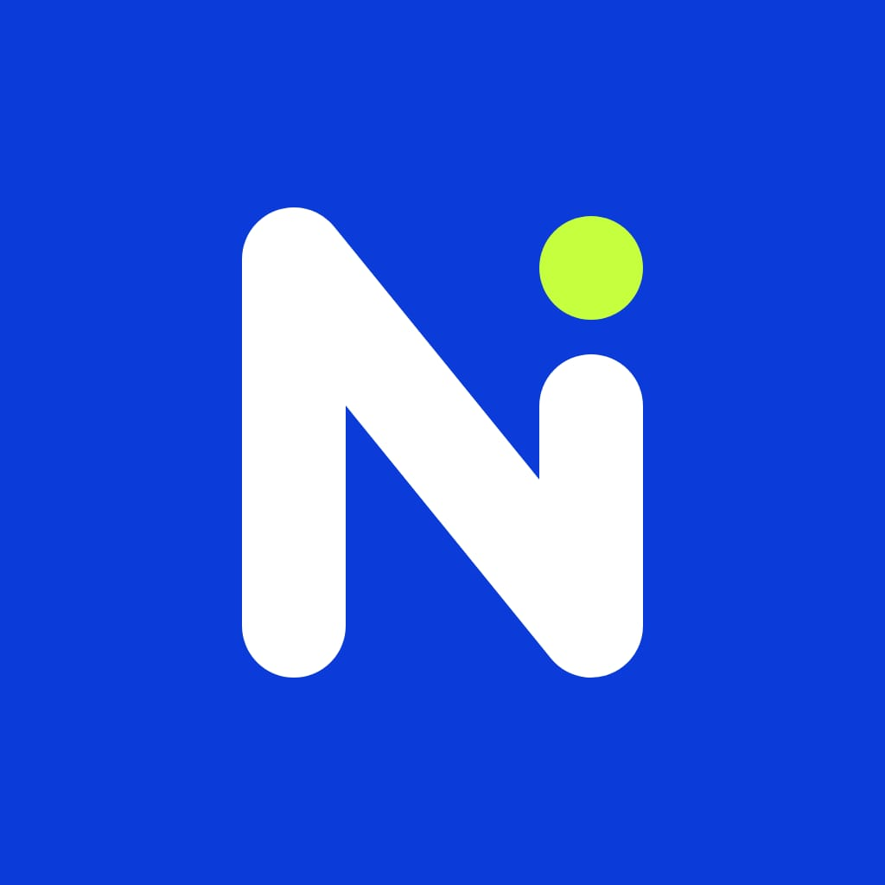

<p align="center">
  
</p>

<h1 align="center">Needio Technologies</h1>
<p align="center">
  <strong>Bengaluru's Premier On-Demand Event Staffing & Gig Workforce Platform</strong>
</p>

<p align="center">
  <a href="https://needio.in"></a>
  <a href="https://needoadmin.vercel.app"></a>
  <a href="mailto:connect@needio.in"></a>
  <a href="https://github.com/orgs/Needio7/projects/1"></a>
</p>

---

## 🌟 About Needio

**Needio** is an enterprise-grade technology ecosystem built to power Bangalore's on-demand gig economy and event staffing. By combining real-time 15-minute dispatch, geofenced GPS attendance verification, automated UPI withdrawals, and multi-tier governance RBAC, Needio connects top event organizers with verified gig professionals seamlessly.

---

## 🏗️ Organization Repository Ecosystem

| Repository | Purpose | Primary Stack |
| :--- | :--- | :--- |
| **[`Needio7/needio`](https://github.com/Needio7/needio)** | Core Worker & Company Platform (Web SPA, Capacitor Android APK & Supabase API) | React 18, Vite, TypeScript, Capacitor 8, Supabase Edge Functions |
| **[`Needio7/needio-admin`](https://github.com/Needio7/needio-admin)** | Enterprise Governance Portal with CEO/CTO RBAC & Zoho SMTP automation | React 18, Vite, TypeScript, Tailwind, Recharts |
| **[`Needio7/needio-testing`](https://github.com/Needio7/needio-testing)** | Dedicated QA Hub: **2 Types of Testing** (White-Box Unit/Security & Black-Box Playwright E2E) | Node Test Runner, Playwright, Chromium/WebKit, OWASP DAST |
| **[`Needio7/needio-docs`](https://github.com/Needio7/needio-docs)** | Technical Architecture, Supabase API specifications & DPDP compliance | Markdown, OpenAPI, KaTeX, System Architecture Blueprints |
| **[`Needio7/Project-management`](https://github.com/Needio7/Project-management)** | Central Engineering Roadmap, Epics, Features, and GitHub Projects tracker | GitHub Issues, Org Issue Types, Milestones |

---

## 🧪 Startup Testing Philosophy: The 2 Types of Testing

Needio adheres to the dual-tier verification paradigm used by world-class high-growth tech startups:

```
┌────────────────────────────────────────────────────────────────────────┐
│                        Needio Verification Matrix                      │
├───────────────────────────────────┬────────────────────────────────────┤
│   Type 1: White-Box / Code-Level  │    Type 2: Black-Box / Outside-In  │
├───────────────────────────────────┼────────────────────────────────────┤
│ • Fast automated unit tests       │ • Playwright browser automation   │
│ • State machine transition audits │ • Real dual-persona simulations    │
│ • In-memory financial TDS checks  │ • Geofenced QR attendance & UPI    │
│ • Role-Based RBAC 403 enforcement │ • Cross-browser & mobile viewport  │
│ • Runs on every commit in seconds │ • Runs nightly & post-deployment   │
└───────────────────────────────────┴────────────────────────────────────┘
```

---

## 🔐 Security & DPDP Compliance

- **Zero Hardcoded Secrets**: All keys, JWT tokens, and credentials managed via encrypted environment injection.
- **Role-Based Isolation**: CEO Super Admin has single-owner master control; CTO/Operations cannot modify maintenance switches or staff roles.
- **DPDP Act 2023 Compliant**: Aadhaar numbers masked, salts non-disclosed, ephemeral memory shredding, and zero unconsented PII exposure.

---

## 📬 Contact & Leadership

- **Founder & CEO**: Naveen Kumar ([naveen@needio.in](mailto:naveen@needio.in))
- **Official Inquiries**: [connect@needio.in](mailto:connect@needio.in)
- **Headquarters**: Bengaluru, Karnataka, India

*Copyright © 2026 Needio Technologies. All rights reserved.*
